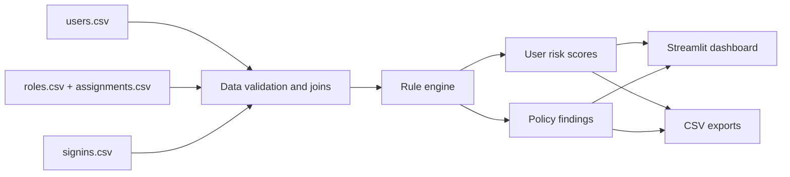

# 🛡️ IdentityGuard | IAM Access Governance & Risk Analytics

[](https://github.com/OWNER/identityguard-iam-analytics/actions/workflows/ci.yml)

A runnable portfolio project demonstrating **identity governance**, **role-based access control (RBAC)**, **segregation of duties (SoD)**, **rule-based security risk scoring**, **data validation**, and **interactive analytics**.

> **Privacy and scope:** All demo identities and logs are synthetic. No tenant credentials are necessary. Findings are *review signals*, not verified security incidents. No access changes are performed.

## Why this project?

Security teams need an auditable way to prioritize access reviews. IdentityGuard joins four relational CSV tables, evaluates explicit policies, assigns explainable risk scores, and generates reviewer-friendly exports. This project is intentionally **rules-based, not machine learning**.

## What it detects

| Rule | Weight | Trigger |
| --- | ---: | --- |
| TERMINATED_ACTIVE | 45 | Terminated identity is still enabled |
| PRIVILEGED_NO_MFA | 30 | Enabled user with privileged entitlement but no MFA |
| SOD_CONFLICT | 35 | Enabled user has incompatible entitlement pair; repeatable per pair |
| STALE_ACCOUNT | 20 | Enabled identity last logged in >45 days ago, up to 90 |
| DORMANT_ACCOUNT | 15 | Enabled identity last logged in >90 days ago |
| LOGIN_FAILURE_SPIKE | 15 | At least 5 failed sign-in events in rolling 30-day calendar window |
| FOREIGN_LOGIN | 10 | A sign-in has a country outside the fictional expected country DE |

Scores are the sum of triggered weights, capped at 100. **High ≥60**, **Medium ≥30**, otherwise **Low**. MFA status is a simple boolean in synthetic data; there is no assurance of MFA quality. Geolocation (including VPN/travel) is not definitive evidence of compromise. Thresholds are examples, not compliance standards. Inactive/dormant rules and SoD checks only apply to enabled identities; authentication anomalies are evaluated for all users to avoid ignoring events associated with disabled identities.

## Architecture



## Quick start (Windows / Linux / macOS)

**Prerequisites:** Python 3.10+ and an internet connection to install dependencies.

```bash
# Extract ZIP, then change into its root folder
cd identityguard
python -m venv .venv
# Linux/macOS:
source .venv/bin/activate
# Windows PowerShell:
# .venv\Scripts\Activate.ps1
python -m pip install -e '.[dev]'
streamlit run app.py
```

Open **http://localhost:8501**. Four reproducible synthetic CSV files are included in `data/`.

### Regenerate synthetic data

```bash
python -m identityguard.cli generate --data-dir data --users 300 --seed 42 --as-of 2026-11-18
```

To make the demo current, set `--as-of` to today's date, and select that same date inside the Streamlit sidebar. The prepackaged dataset is anchored to **2026-11-18** to keep demos and tests reproducible. If you audit that static snapshot much later, inactivity scores will naturally change.

### Generate audit CSV reports

```bash
python -m identityguard.cli analyze --data-dir data --out-dir reports --as-of 2026-11-18
```

Outputs: `reports/user_risks.csv` (one row per identity) and `reports/audit_findings.csv` (one row per triggered rule). `reports/` is ignored by Git. Generated reference exports are available in `examples/`.

### Run tests and lint

```bash
pytest -q
ruff check src tests app.py
```

### Run in Docker

```bash
docker build -t identityguard .
docker run --rm -p 8501:8501 identityguard
```

Open **http://localhost:8501**. The image embeds only synthetic CSV data, not secrets.

## Data model

- `users.csv`: `user_id`, name, department, status, enabled, mfa_enabled, last_login (UTC)
- `roles.csv`: `role_id`, role_name, department, privileged
- `assignments.csv`: user_id, role_id (many-to-many)
- `signins.csv`: event_id, user_id, timestamp (UTC), success, country

`identityguard.data.load_data()` checks required fields, unique primary keys, valid boolean/status/date formats, and foreign-key integrity before analysis.

## Dashboard

The Streamlit app supports department/risk filters; a score distribution; findings by rule; department-level aggregates; individual account review with role assignments; audit finding recommendations; policy threshold controls; CSV exports; and a rule documentation tab.

## Repository layout

```text
identityguard/
├── .github/workflows/ci.yml
├── data/{users,roles,assignments,signins}.csv
├── examples/{user_risks_sample,audit_findings_sample}.csv
├── src/identityguard/{config,data,generate,scoring,cli}.py
├── tests/
├── app.py
├── Dockerfile
├── requirements.txt
├── requirements-dev.txt
├── pyproject.toml
├── LICENSE
└── README.md
```

## Important limitations and responsible use

This is a **portfolio demonstration**, not a production identity governance or compliance product. The dataset is fictional and generated from scripted patterns. Detection quality is not measured against real incident labels. Country is a coarse field and not a reliable threat signal. Role privilege and SoD conflicts are modeled simplistically. Scores are heuristic points, *not* calibrated incident probabilities. Never use these recommendations to disable real identities automatically. A production implementation would need authorization checks, robust audit logs, encrypted secret storage, time-aware entitlements, owner approvals, tenant-specific policy rules, privacy reviews, validation with security stakeholders, and integration testing against authorized APIs.

## Publish to GitHub

1. Create a new **public** repository named `identityguard-iam-analytics` in GitHub (leave README initialization unchecked).
2. Replace `OWNER` in the CI badge at the top of this README with your username.
3. From this project folder run:

   ```bash
   git init
   git add .
   git commit -m "Build IdentityGuard IAM analytics demo"
   git branch -M main
   git remote add origin https://github.com/YOUR_USERNAME/identityguard-iam-analytics.git
   git push -u origin main
   ```

   If authentication prompts fail, use GitHub CLI (`gh auth login`) or a supported credential manager. Password-based HTTPS Git authentication is not supported.
4. Confirm the Actions tab shows successful automated checks and add dashboard screenshots to the README if desired.
5. Optionally deploy with a Streamlit-compatible hosting service (review its free-tier limits and data-privacy settings). The Dockerfile allows hosting on your own Docker server.

## Suggested CV summary (after verifying functionality)

**IdentityGuard | Python, pandas, Streamlit, IAM/RBAC**: Developed an explainable access governance analytics platform that analyzes synthetic identity and sign-in records, flags excessive privilege/MFA gaps and SoD conflicts, and produces audit-ready reports with automated CI tests.

## License

MIT.
